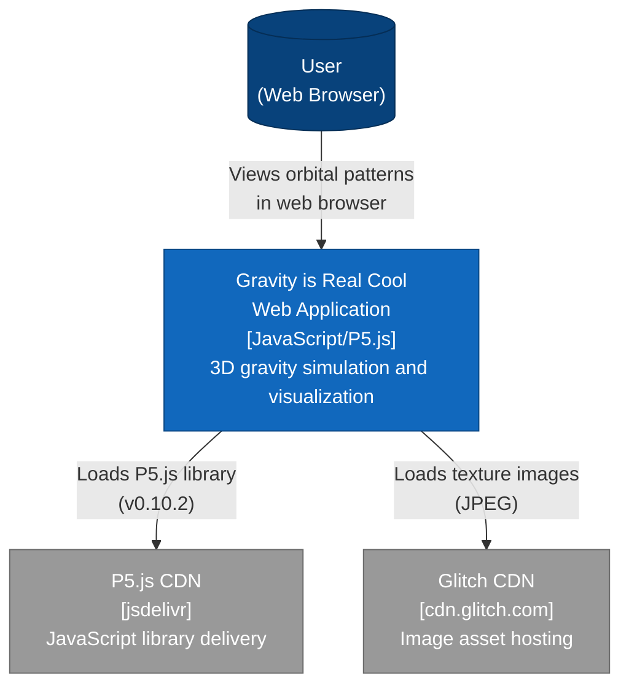
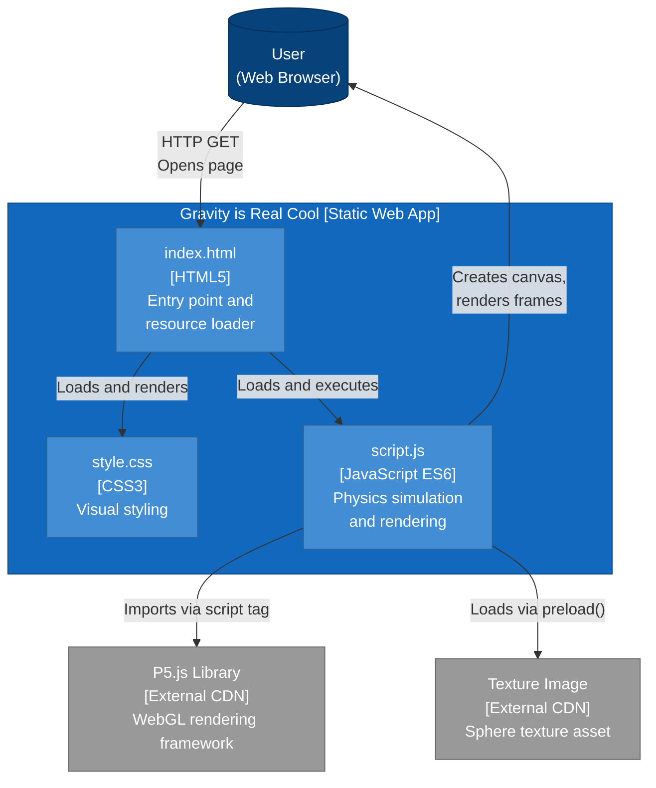
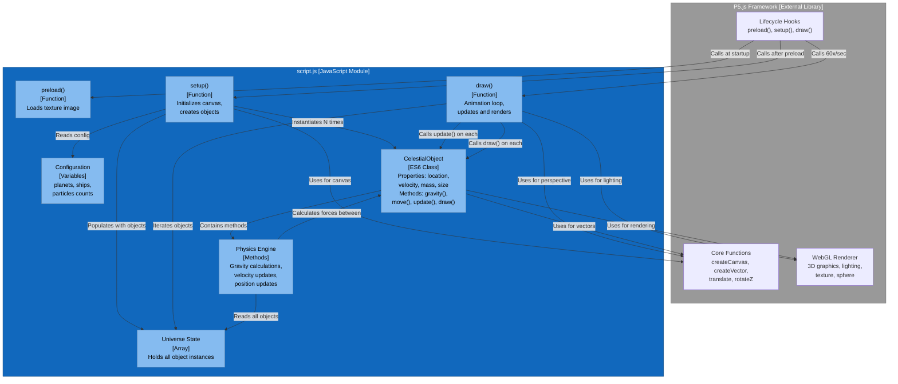
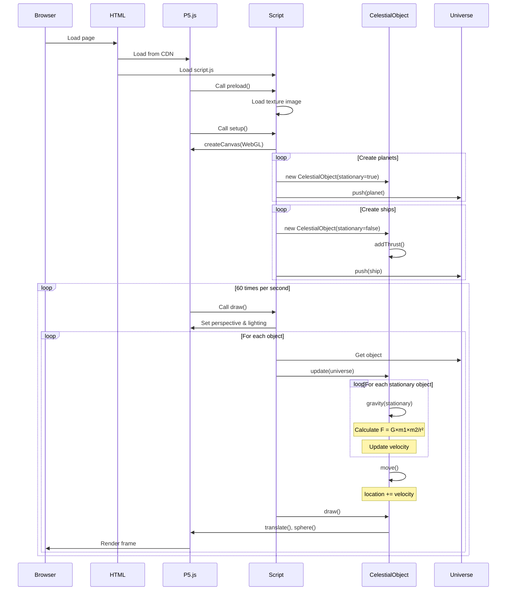
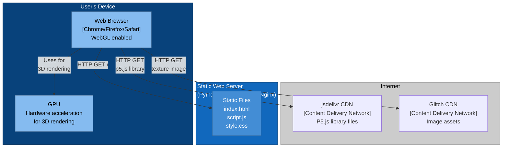

# C4 Architecture Diagrams

## Context Diagram

The system context shows how users interact with the application and its external dependencies.

## Container Diagram

The container diagram shows the major executable units within the application.

## Component Diagram

The component diagram shows the internal structure of script.js, the main application logic.

## Data Flow Diagram

Shows how data flows through the system during runtime.

## Deployment Diagram

Shows how the application is deployed and accessed.

